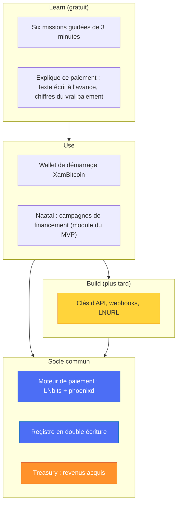

# 01 · Problème et vision

> Le fond de la présentation de XamBitcoin : le problème, l'idée, pourquoi Bitcoin et Lightning, ce qu'on ne dit pas. Sources : `XamBitcoin_Proposition_Concrete.md` (source de vérité du contenu), `docs/REQUIREMENTS.md`, `docs/BUSINESS_RULES.md`, `docs/DECISIONS.md`. L'histoire prête à coller dans Devpost est dans [`02-histoire-devpost.md`](02-histoire-devpost.md).

---

## 1. Le problème

Même quand on suit Bitcoin de près, des mécanismes échappent : ce qu'est un sat, ce que contient une facture Lightning, pourquoi un paiement coûte quelques sats de frais de routage. Les tutoriels expliquent d'abord et laissent essayer ensuite, souvent sur un réseau de test où rien n'est en jeu. On comprend mal ce qu'on n'a jamais fait pour de vrai.

## 2. L'idée

**Apprends Bitcoin. Utilise-le. Construis avec.** XamBitcoin est un socle Bitcoin et Lightning commun (wallet, moteur de paiement, registre, reçus, trésorerie) sur lequel on branche trois couches.

- **Learn** : on fait une vraie opération, puis on t'explique, au moment précis où elle se passe.
- **Use** : le dernier pas de Learn est le premier acte réel de Use : lancer une campagne Naatal.
- **Build** : une couche pour les développeurs, plus tard.

## 3. Pourquoi Bitcoin et Lightning

- Un bitcoin se découpe en 100 millions de sats : on manipule des nombres entiers et simples (21 sats, 1 000 sats).
- Lightning permet d'envoyer ces sats en quelques secondes pour presque rien : adapté aux petits montants d'une campagne locale.
- LNURL-pay donne un QR permanent qui génère une facture neuve à chaque scan : idéal pour recevoir des dons.

## 4. Le modèle

| Flux | Commission |
|---|---|
| Réception personnelle | Aucune |
| Retrait ou envoi | Aucune, seulement les frais réels du réseau |
| Don à une campagne Naatal | Règle configurable : pourcentage, minimum, maximum (1 %, min 1, max 500 au départ), **affichée avant le paiement** |

Le Treasury ne contient que des revenus acquis, jamais des fonds d'utilisateurs. Le wallet est un wallet de démarrage, plafonné : XamBitcoin n'est pas une banque.

## 5. Ce qu'on ne dit pas

- Pas d'application mobile ni d'APK pour la soumission.
- Pas de « décentralisé » : le wallet est custodial, plafonné, avec retrait libre.
- Pas d'IA qui explique les paiements : des textes écrits à la main.
- Pas de promesse sur Wave, Orange Money ou d'autres moyens de paiement locaux.
- Voir la fiche complète dans [`05-reel-simule-vision-et-jury.md`](05-reel-simule-vision-et-jury.md).
