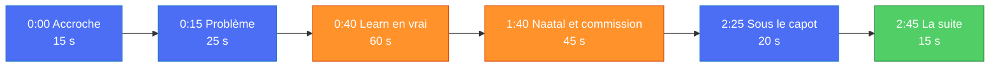

# 03 · Script de la vidéo (3 minutes)

> Script minuté pour la vidéo de présentation Devpost, sur le modèle `[DIRE]` / `[MONTRER]`. Chaque image à montrer est dans [`06-captures-et-medias.md`](06-captures-et-medias.md) et chaque affirmation est étiquetée réelle, simulée ou à venir dans [`05-reel-simule-vision-et-jury.md`](05-reel-simule-vision-et-jury.md). **Durée maximale de la vidéo : à vérifier sur la page « Rules » du hackathon** (non lue ici). Le texte parlé est en français ; si la vidéo doit être en anglais, traduire phrase par phrase en gardant les mêmes chiffres.

---

## 1. Déroulé

| Temps | Durée | Objectif unique |
|---|---|---|
| 0:00 à 0:15 | 15 s | Dire l'idée : on apprend Bitcoin **en le faisant** |
| 0:15 à 0:40 | 25 s | Le problème : on explique avant, on essaie après, sur un réseau de test |
| 0:40 à 1:40 | 60 s | Montrer de vrais sats : mission 3, 21 sats reçus |
| 1:40 à 2:25 | 45 s | Montrer une campagne Naatal et la commission **avant** le paiement |
| 2:25 à 2:45 | 20 s | Sous le capot : ledger, relecture du paiement, un seul point d'entrée public |
| 2:45 à 3:00 | 15 s | La suite et l'appel final |

---

## 2. Script

### 0:00 à 0:15 · Accroche
> **[DIRE]** « Bitcoin, on te l'explique avant de te laisser essayer. Avec XamBitcoin, c'est l'inverse : tu fais une vraie opération, puis on t'explique ce qui vient de se passer. »
>
> **[MONTRER]** `01-accueil.png`, puis le début de `clip-A-pages-publiques.webm`.

### 0:15 à 0:40 · Problème
> **[DIRE]** « Même quand on suit Bitcoin, des mécanismes échappent : qu'est-ce qu'un sat, que contient une facture, pourquoi un paiement coûte quelques sats de frais. Les tutoriels restent théoriques ou utilisent un réseau de test où rien n'est en jeu. »
>
> **[MONTRER]** `02-accueil-modele.png` (les six missions), `40-learn-use-build.png` (Learn, Use, Build).

### 0:40 à 1:40 · Learn, en vrai
> **[DIRE]** « Je crée un compte sur le site en ligne. Mission 1 : un quiz sur le sat. Mission 2 : j'active mon wallet de démarrage, solde zéro. Mission 3 : je demande ma récompense. »
>
> **[MONTRER]** `clip-C-missions-1-et-2.webm` (ou `10-mission1-quiz.png` puis `09b-missions-progression.png`).
>
> **[DIRE]** « Ce sont de vrais sats sur Bitcoin, par Lightning : 21 sats. Le solde passe à 21. L'historique affiche une récompense Learn, réglée. Les chiffres viennent du vrai paiement, pas d'un exemple. »
>
> **[MONTRER]** `clip-D-mission-3-reelle.webm`, puis `32-tableau-de-bord-21-sats.png` et `33-finance-transaction.png`.
>
> **[DIRE]** « L'explication est écrite à l'avance, pas générée par une IA. Seuls les chiffres changent. »

### 1:40 à 2:25 · Naatal et commission
> **[DIRE]** « Dernière étape : lancer une campagne de financement, Naatal. Un titre, un objectif en sats, un lien. »
>
> **[MONTRER]** `15-campagne-formulaire.png`, puis `17-campagne-frais-avant-paiement.png`.
>
> **[DIRE]** « Avant de payer, le contributeur voit : 1 000 sats, dont 10 sats de frais de service, 990 au porteur de la campagne. Un QR permanent et une adresse Lightning : n'importe quel wallet peut payer. La commission, 1 %, ne touche jamais une réception personnelle ni un retrait. »
>
> **[MONTRER]** `42-commission-treasury.png`. **Si le don réel du niveau 3 a été fait** : l'insérer ici avec sa capture (paiement, statut Payé, ligne du Treasury).

### 2:25 à 2:45 · Sous le capot
> **[DIRE]** « Un registre en double écriture : chaque mouvement est un débit et un crédit de même montant. Chaque paiement reçu est relu auprès du moteur de paiement avant d'être crédité, un rejeu ne crédite jamais deux fois. Un seul point d'entrée public, un moteur Lightning jamais exposé. »
>
> **[MONTRER]** `43-production-architecture.png`, puis `44-incoming-payment.png`.

### 2:45 à 3:00 · La suite
> **[DIRE]** « Ensuite : l'application mobile, les autres modules sur le même socle, et la couche Build pour les développeurs. XamBitcoin : apprends Bitcoin, utilise-le, construis avec. »
>
> **[MONTRER]** `01-accueil.png` (carte de fin) avec l'adresse `https://xambitcoin.com`.

---

## 3. Version de secours de 60 secondes

> **[DIRE]** « XamBitcoin t'apprend Bitcoin en le faisant. Tu crées un compte, tu réponds à un quiz, tu actives ton wallet, et tu reçois 21 vrais sats par Lightning : le solde et l'historique le prouvent. Puis tu lances une campagne Naatal : avant chaque don, le contributeur voit les frais de service. Derrière, un registre en double écriture et une relecture de chaque paiement. Le site est en ligne : xambitcoin.com. »
>
> **[MONTRER]** `01-accueil`, `31-mission3-apres`, `33-finance-transaction`, `17-campagne-frais-avant-paiement`.

## 4. Règles d'or de l'oral

- Une idée par phrase, des chiffres précis et petits (21, 10, 990).
- Dire ce qui est réel **avant** qu'on le demande : « ce sont de vrais sats ». Dire ce qui est démonstration : « cette page est une démonstration ».
- Ne jamais dire : « application mobile disponible », « explication générée par IA », « mission 6 jouable », « banque ».
- Ne jamais montrer : un terminal, l'administration de LNbits, une adresse IP, un secret.

## 5. Outils de tournage

| Besoin | Outil |
|---|---|
| Captures et clips bruts | Déjà faits : dossier `media/` et `clips/` |
| Voix | Enregistrement à part (téléphone ou OBS), dans un endroit calme |
| Montage | CapCut ou DaVinci Resolve : poser les clips, couper les attentes, ajouter la voix |
| Sous-titres | Ajoutés dans l'outil de montage, ou ceux de YouTube après téléversement |
| Hébergement | YouTube ou Vimeo (lien demandé par Devpost) |
