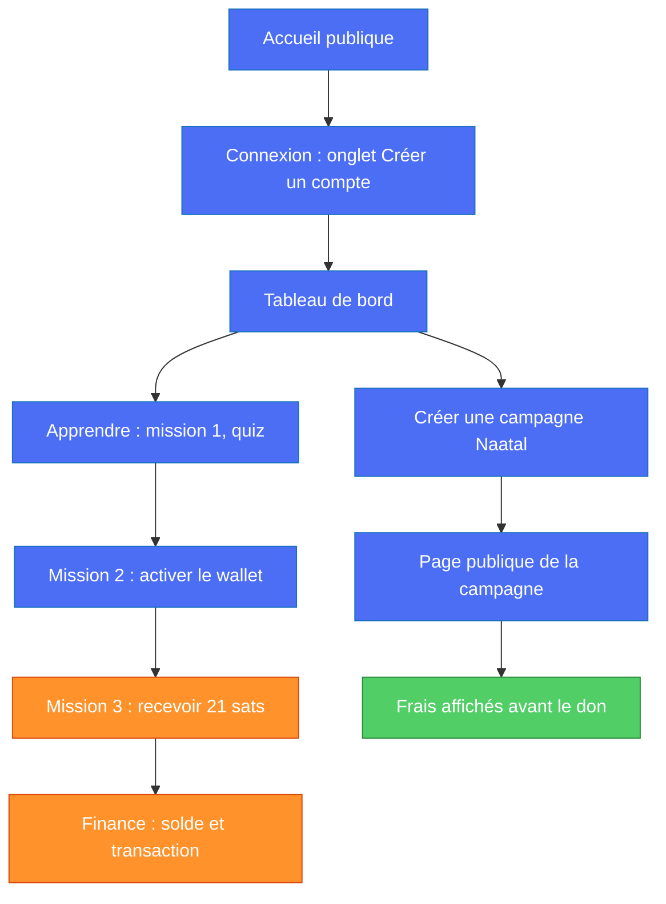

# 04 · Flow des écrans de la démonstration

> Parcours écran par écran du site en ligne (`https://xambitcoin.com`) pour la démonstration, avec la phrase à dire et le point d'attention. Sources : `docs/SCREENS.md`, `apps/portal/src/App.tsx`, et les captures du 2026-11-19 ([`06-captures-et-medias.md`](06-captures-et-medias.md)). Script minuté : [`03-script-video.md`](03-script-video.md).

---

## 1. Parcours

## 2. Écran par écran

| # | Écran (route) | Action de la démonstration | Phrase d'accompagnement | Point d'attention |
|---|---|---|---|---|
| 1 | Accueil (`/`) | Montrer le titre et le bouton « Voir l'aperçu du tutoriel » | « Tu fais d'abord, on t'explique ensuite. » | Les badges « APK Android, bientôt » sont honnêtes : ne pas les cliquer |
| 2 | Connexion (`/connexion`) | Onglet « Créer un compte », e-mail et mot de passe, « Créer mon compte » | « Un compte, pas de seed demandée. » | Utiliser un e-mail fictif de test, jamais le vrai |
| 3 | Tableau de bord (`/dashboard`) | Solde, progression 0 sur 6, prochaine étape | « Rien n'est caché : ton solde et ta progression. » | Compte neuf : « Tu n'as pas encore de wallet » |
| 4 | Missions (`/apprendre`) | Mission 1, trois réponses, « Valider mes réponses » | « La correction se fait sur le système, pas dans ton navigateur. » | Réponses : 100 000 000 ; Payer vite et à petit prix ; La plus petite unité courante de bitcoin |
| 5 | Mission 2 | « Activer mon wallet » | « Un wallet de démarrage, plafonné à 100 000 sats. » | L'activation peut prendre quelques secondes |
| 6 | Mission 3 | « Recevoir ma récompense » | « Ce sont de vrais sats : 21. » | **Argent réel** : une seule fois par compte |
| 7 | Finance (`/finance`) | Solde 21 sats, transaction « Récompense Learn, Réglé » | « Le chiffre vient du vrai paiement. » | Attendre l'actualisation si la transaction tarde |
| 8 | Créer une campagne (`/naatal/nouvelle`) | Titre, objectif, lien, « Créer la campagne » | « Un titre, un objectif, un lien : c'est tout. » | Titre sans donnée personnelle |
| 9 | Page de campagne (`/naatal/<lien>`) | Choisir 1 000 sats | « Avant de payer : 1 000 sats, dont 10 de frais, 990 au porteur. » | C'est la capture la plus importante de la démonstration |
| 10 | Aperçu (`/demo`, `/naatal-demo`) | Montrer le bandeau « Données de démonstration » | « Cette page est sans argent et étiquetée. » | À montrer pour prouver l'honnêteté |

## 3. Routes du portail

| Type | Routes |
|---|---|
| Publiques | `/`, `/demo`, `/comment-ca-marche`, `/connexion`, `/naatal-demo`, `/naatal/<lien>` (réelle), `/impact`, `/securite`, `/telecharger`, `/build` |
| Privées (connexion exigée) | `/dashboard`, `/apprendre`, `/naatal/nouvelle`, `/finance`, `/apercu` |

Sans session, une route privée renvoie vers `/connexion` : c'est voulu.

## 4. Préparation technique avant de filmer

- [ ] Compte de test créé avec un e-mail `@example.org`.
- [ ] Le site répond : `https://api.xambitcoin.com/api/healthz` renvoie `ok`.
- [ ] Le Budget Learn contient assez de sats pour la mission 3 (21 par compte).
- [ ] Navigateur en 1200 par 800 points, zoom à 100 %, aucune extension visible, aucun onglet personnel.
- [ ] Pour un don réel : un wallet Lightning prêt à payer 100 sats.

## 5. Plan B

| Si... | Alors... |
|---|---|
| Le site ne répond pas | Utiliser les clips bruts (`clip-A` à `clip-D`) et dire qu'ils ont été enregistrés sur le site en ligne le 2026-11-19 |
| La mission 3 affiche « connexion lente » | Attendre 30 secondes et réessayer une fois ; sinon montrer la capture `31-mission3-apres.png` et le dire |
| Le don réel n'est pas payé à temps | Montrer la page de campagne et la ligne de frais, sans dire qu'un don a été reçu |
| Une capture montre un e-mail réel | Ne pas publier : refaire avec un compte de test |
