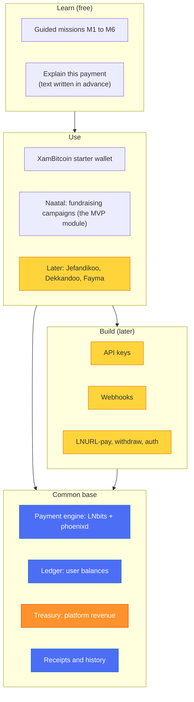
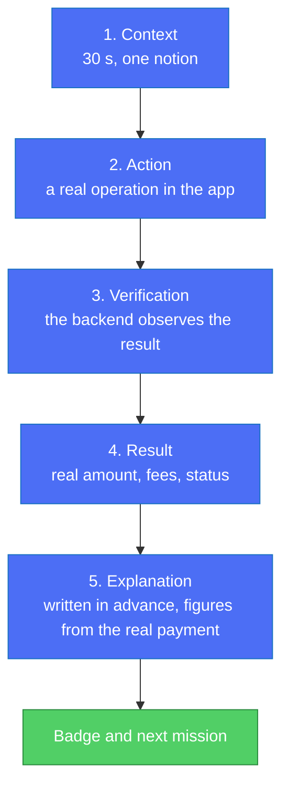
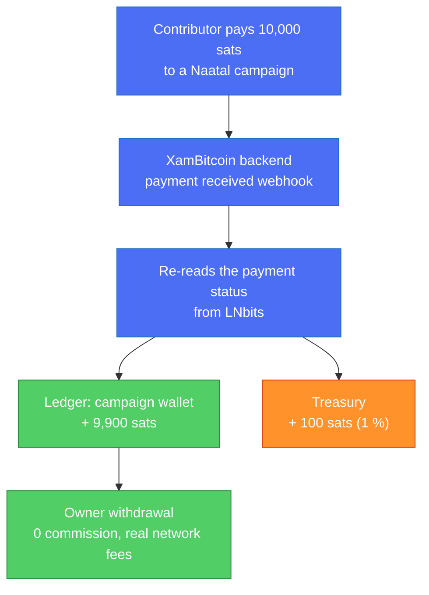
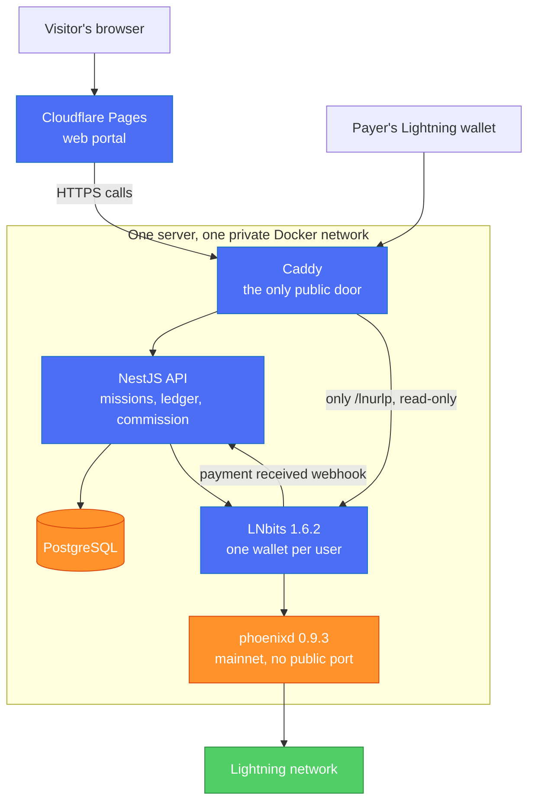
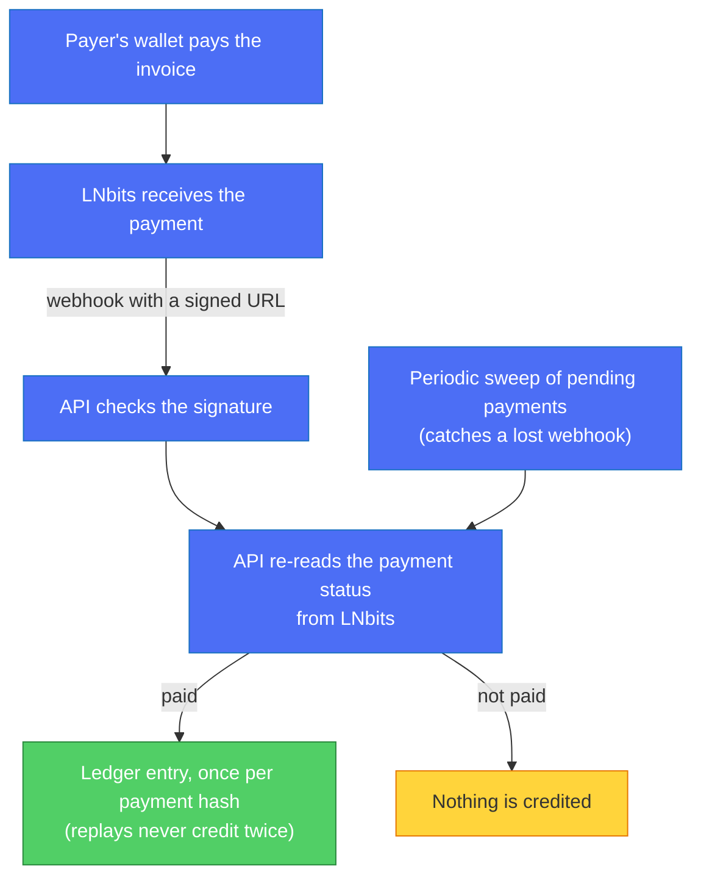
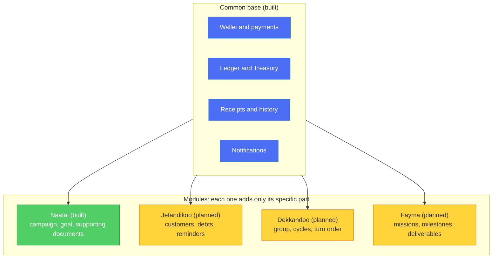
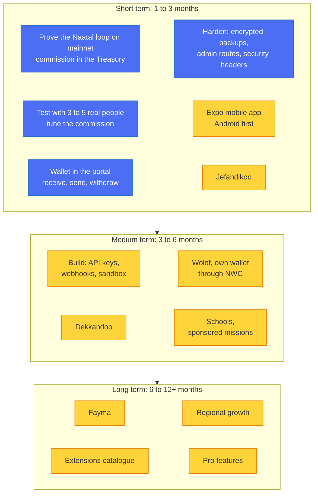
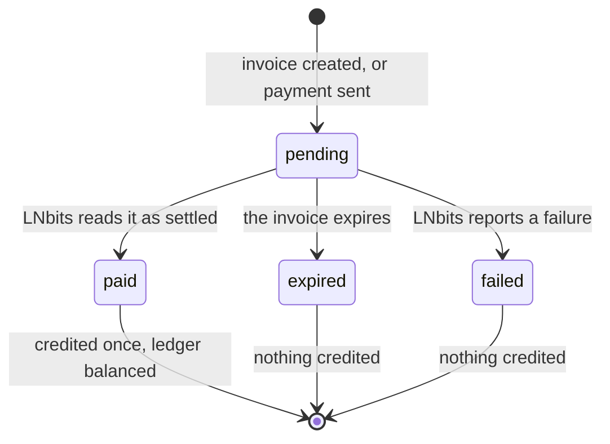
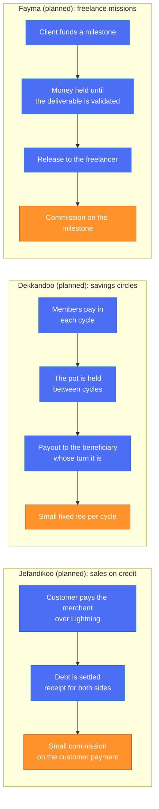

# 07 · Schémas Mermaid (sources)

> Les neuf schémas de la présentation de XamBitcoin, en texte Mermaid : **GitHub les affiche directement**. **Devpost, lui, n'affiche pas Mermaid** (constaté) : pour Devpost, les mêmes schémas existent en **images PNG** dans `media/` (`40-` à `48-`) et c'est ce que l'histoire utilise. Pour modifier un schéma : changer le texte ici, puis régénérer le PNG. Couleurs de la palette du projet : bleu = étape, vert = réel ou réussi, orange = argent, jaune = prévu ou en attente. Chaque schéma ne montre que ce que le code fait, ou ce qui est marqué « planned ».

---

## 1. Learn, Use, Build et le socle commun (`40-learn-use-build.png`)

## 2. La boucle d'une mission (`41-mission-loop.png`)

## 3. Commission et Treasury, exemple de 10 000 sats (`42-commission-treasury.png`)

## 4. Architecture de production (`43-production-architecture.png`)

## 5. Crédit d'un paiement reçu (`44-incoming-payment.png`)

## 6. Les modules sur le socle commun (`45-modules-on-the-base.png`)

Note : « Notifications » est dans la vision de la Proposition (`XamBitcoin_Proposition_Concrete.md`, § 5) ; ce n'est pas une brique que le code expose aujourd'hui.

## 7. La feuille de route en trois horizons (`46-roadmap.png`)

Proposition d'ordre, pas un engagement : les durées sont des estimations.

## 8. La vie d'un paiement (`47-payment-states.png`)

## 9. Les trois modules prévus (`48-module-flows.png`)

Tout est **prévu**, rien n'est construit. Les commissions sont des valeurs illustratives de la Proposition (§ 3).

