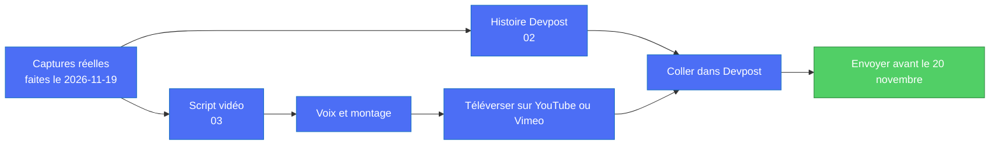

# XamBitcoin - Presentation kit / Dossier de présentation (Dakar Bitcoin Hack)

**Learn Bitcoin. Use it. Build with it.** / **Apprends Bitcoin. Utilise-le. Construis avec.**

[English](#english) | [Français](#français)

---

## English

> Everything needed to submit XamBitcoin on Devpost and produce the video: story to paste, script, screen flow, honesty sheet, real captures of the live site, diagrams. Facts taken from the repository, checked on the live site on 2026-11-19. The form is inspired by a pitch folder from another project; none of its content is reused.

### 1. In one sentence

**Learn Bitcoin by doing it**: six three-minute missions with real Lightning micro-sats, up to a first fundraising campaign (Naatal), live at `https://xambitcoin.com`.

### 2. The files

| File | Role | When to read it |
|---|---|---|
| [`01-probleme-et-vision.md`](01-probleme-et-vision.md) | The substance: problem, idea, model | Before everything else |
| [`02-histoire-devpost.md`](02-histoire-devpost.md) | **English text to paste into Devpost**, tagline, tags, links | To fill in the form |
| [`03-script-video.md`](03-script-video.md) | Timed 3-minute script, 60-second version | Before recording the voice |
| [`04-flow-ecrans-demo.md`](04-flow-ecrans-demo.md) | Screen by screen, plan B | Before filming |
| [`05-reel-simule-vision-et-jury.md`](05-reel-simule-vision-et-jury.md) | What is real and what is not, 14 jury questions | Before the video and before a jury |
| [`06-captures-et-medias.md`](06-captures-et-medias.md) | Captures, diagrams, clips, order of the 15 images | For the gallery and the editing |
| [`07-schemas-mermaid.md`](07-schemas-mermaid.md) | Mermaid sources of the 9 diagrams (GitHub displays them) | To edit a diagram (Devpost does not display Mermaid: it uses the PNGs) |
| [`08-site-des-images.md`](08-site-des-images.md) | The small public image site (Netlify) and how to deploy it | To give Devpost public image links |
| `media/` | PNG images (captures of the live site and diagrams) | For Devpost and the video |

### 3. Flow

---

## Français

> Tout ce qu'il faut pour soumettre XamBitcoin sur Devpost et produire la vidéo : histoire à coller, script, flow des écrans, fiche d'honnêteté, captures réelles du site en ligne, schémas. Faits relevés dans le dépôt, vérifiés sur le site en ligne le 2026-11-19. Forme inspirée d'un dossier de pitch d'un autre projet ; rien de son contenu n'est repris.

### 1. En une phrase

**Apprends Bitcoin en le faisant** : six missions de trois minutes avec de vrais micro-sats Lightning, jusqu'à une première campagne de financement (Naatal), en ligne sur `https://xambitcoin.com`.

### 2. Les fichiers

| Fichier | Rôle | Quand le lire |
|---|---|---|
| [`01-probleme-et-vision.md`](01-probleme-et-vision.md) | Le fond : problème, idée, modèle | Avant tout le reste |
| [`02-histoire-devpost.md`](02-histoire-devpost.md) | **Texte anglais à coller dans Devpost**, accroche, étiquettes, liens | Pour remplir le formulaire |
| [`03-script-video.md`](03-script-video.md) | Script minuté de 3 minutes, version de 60 secondes | Avant d'enregistrer la voix |
| [`04-flow-ecrans-demo.md`](04-flow-ecrans-demo.md) | Écran par écran, plan B | Avant de filmer |
| [`05-reel-simule-vision-et-jury.md`](05-reel-simule-vision-et-jury.md) | Ce qui est réel ou non, 14 questions du jury | Avant la vidéo et avant un jury |
| [`06-captures-et-medias.md`](06-captures-et-medias.md) | Captures, schémas, clips, ordre des 15 images | Pour la galerie et le montage |
| [`07-schemas-mermaid.md`](07-schemas-mermaid.md) | Sources Mermaid des 9 schémas (GitHub les affiche) | Pour modifier un schéma (Devpost n'affiche pas Mermaid : il utilise les PNG) |
| [`08-site-des-images.md`](08-site-des-images.md) | Le petit site public des images (Netlify) et son déploiement | Pour donner à Devpost des liens d'images publics |
| `media/` | Images PNG (captures du site en ligne et schémas) | Pour Devpost et la vidéo |

### 3. Déroulé

