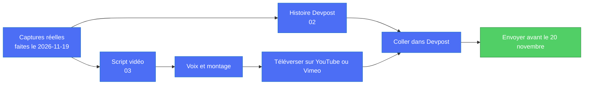

# Dossier de présentation XamBitcoin (Dakar Bitcoin Hack)

> Tout ce qu'il faut pour soumettre XamBitcoin sur Devpost et produire la vidéo : histoire à coller, script, flow des écrans, fiche d'honnêteté, captures réelles du site en ligne, schémas. Faits relevés dans le dépôt, vérifiés sur le site en ligne le 2026-11-19. Forme inspirée d'un dossier de pitch d'un autre projet ; rien de son contenu n'est repris.

---

## 1. En une phrase

**Apprends Bitcoin en le faisant** : six missions de trois minutes avec de vrais micro-sats Lightning, jusqu'à une première campagne de financement (Naatal), en ligne sur `https://xambitcoin.com`.

## 2. Les fichiers

| Fichier | Rôle | Quand le lire |
|---|---|---|
| [`01-probleme-et-vision.md`](01-probleme-et-vision.md) | Le fond : problème, idée, modèle | Avant tout le reste |
| [`02-histoire-devpost.md`](02-histoire-devpost.md) | **Texte anglais à coller dans Devpost**, accroche, étiquettes, liens | Pour remplir le formulaire |
| [`03-script-video.md`](03-script-video.md) | Script minuté de 3 minutes, version de 60 secondes | Avant d'enregistrer la voix |
| [`04-flow-ecrans-demo.md`](04-flow-ecrans-demo.md) | Écran par écran, plan B | Avant de filmer |
| [`05-reel-simule-vision-et-jury.md`](05-reel-simule-vision-et-jury.md) | Ce qui est réel ou non, 14 questions du jury | Avant la vidéo et avant un jury |
| [`06-captures-et-medias.md`](06-captures-et-medias.md) | Captures, schémas, clips, ordre des 15 images | Pour la galerie et le montage |
| [`07-schemas-mermaid.md`](07-schemas-mermaid.md) | Sources Mermaid des 9 schémas (GitHub les affiche) | Pour modifier un schéma (Devpost n'affiche pas Mermaid : il utilise les PNG) |
| `media/` | Images PNG (captures du site en ligne et schémas) | Pour Devpost et la vidéo |

## 3. Déroulé

## 4. Check-list d'envoi

- [ ] **Le dépôt GitHub est public** et son lien fonctionne en navigation privée.
- [ ] La branche de ce dossier est fusionnée dans `main` (les liens d'images de l'histoire pointent vers `main`), sinon téléverser les images à la main.
- [ ] Nom, accroche (moins de 200 caractères), histoire et étiquettes collés depuis [`02`](02-histoire-devpost.md).
- [ ] Liens « Try it out » : `https://xambitcoin.com` répond, et le dépôt.
- [ ] 15 images au plus, chacune sous 5 Mo, dans l'ordre de [`06`](06-captures-et-medias.md).
- [ ] Vidéo : durée maximale confirmée sur la page « Rules », puis lien YouTube ou Vimeo.
- [ ] Le Budget Learn contient assez de sats si un jury essaie la mission 3 (21 par compte).
- [ ] `www.xambitcoin.com` ne se résout pas : ne l'écrire nulle part.
- [ ] Aucun e-mail réel, adresse IP ni secret visible dans une image ou une vidéo.
- [ ] Relire l'aperçu Devpost sur téléphone avant « Submit ».

## 5. Trois règles de la présentation

1. **Une idée par phrase**, des chiffres précis et petits.
2. **Dire ce qui est réel avant qu'on le demande**, et ce qui est démonstration.
3. **Ne rien promettre qui n'existe pas** : pas de mobile, pas d'IA qui explique, pas de mission 6 jouable.

## 6. Sources dans le dépôt

`XamBitcoin_Proposition_Concrete.md`, `docs/ROADMAP_NEXT_STEPS.md`, `docs/KNOWN_ISSUES.md`, `docs/DECISIONS.md`, `docs/BUSINESS_RULES.md`, `docs/DATABASE_MODEL.md`, `docs/TESTING.md`, `docs/DEPLOYMENT.md`, `docs/LESSONS_LEARNED.md`.
